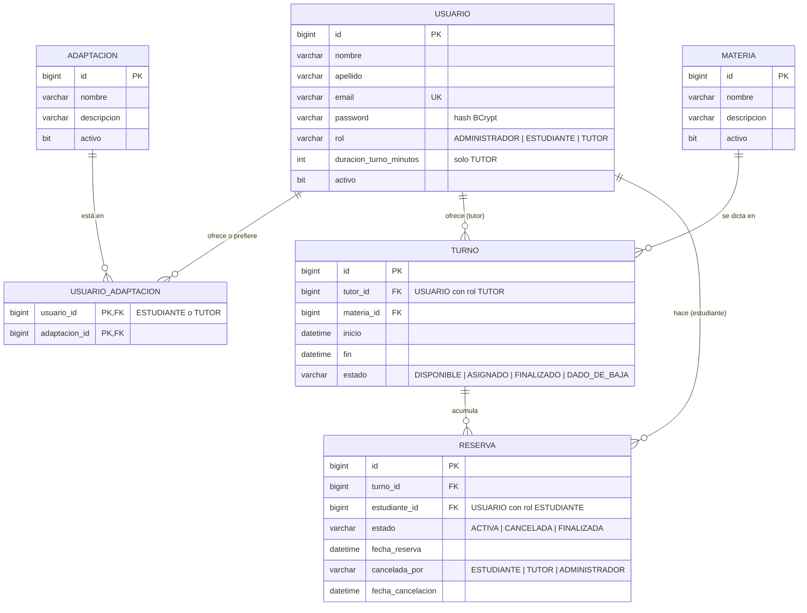

# Modelo de datos

Diagrama entidad-relación de Booktor. Cada tabla se crea con un changeset de Liquibase, y Hibernate solo valida el esquema.

## Cómo leer el diagrama

- `||--o{`: uno a muchos, donde el lado "muchos" puede estar vacío (un tutor puede no tener turnos todavía).
- `PK` clave primaria, `FK` clave foránea, `UK` valor único.

## Usuarios

Administradores, estudiantes y tutores están en una sola tabla, `USUARIO`, y se distinguen por `rol`. El tutor es el único que tiene un dato propio, `duracion_turno_minutos`; para los otros roles queda vacío.

La base no impide, por ejemplo, que un turno apunte a un estudiante. Esas reglas las valida el servicio (RN-02 y RN-03 de [03-definiciones.md](03-definiciones.md)), cada una con su prueba:

- Solo un tutor puede tener turnos y duración de turno, y la duración es obligatoria.
- Solo un estudiante puede tener reservas.
- `USUARIO_ADAPTACION` guarda las adaptaciones preferidas si el usuario es estudiante y las ofrecidas si es tutor. Un administrador no tiene adaptaciones.

Login:
- Se usa el login por formulario de Spring Security: el usuario se busca por `email` y su `rol` define a qué operaciones accede.
- `password` guarda el hash BCrypt de la contraseña, nunca el texto plano. El del administrador inicial llega al changeset de Liquibase como parámetro, ya encriptado.
- La baja lógica de un estudiante o tutor pone `activo` en falso. Así deja de aparecer en los listados y tampoco puede iniciar sesión.

## Decisiones del modelo

| Decisión | Motivo |
|---|---|
| Todos los usuarios están en una sola tabla `USUARIO`, con su rol. | El modelo queda simple: una entidad, un ABML base y un solo lugar donde buscar al iniciar sesión. Las validaciones por rol las hace el servicio. |
| Las adaptaciones de estudiantes y tutores comparten la tabla `USUARIO_ADAPTACION`. | El significado (preferida u ofrecida) lo da el rol del usuario, sin duplicar tablas. |
| Las adaptaciones están en el perfil del tutor y no en cada turno. | Mantiene acotado el MVP. Elegirlas por bloque queda como extra. |
| Las relaciones muchos a muchos son tablas intermedias sin datos propios. | Solo registran la asociación. En JPA se mapean con `@ManyToMany` y `@JoinTable`. |
| Cada turno guarda su tutor y su materia. | El tutor publica disponibilidad por materia, y la búsqueda del estudiante parte de la materia. |
| El turno guarda `inicio` y `fin` como fecha y hora completas. | Simplifica comparar superposiciones (`inicioA < finB && inicioB < finA`) y descartar los turnos que ya pasaron. |
| `cancelada_por` y `fecha_cancelacion` solo tienen valor si la reserva está CANCELADA. | Registra quién canceló sin necesitar otra tabla. |
| Turno y reserva no tienen `activo`. | Su ciclo de vida, baja incluida, lo manejan los estados: un turno DISPONIBLE dado de baja pasa a DADO_DE_BAJA. Así no hay combinaciones sin sentido, como un turno ASIGNADO e inactivo. |
| El nombre de materias y adaptaciones no tiene restricción única en la base. | Solo no se repite entre las activas (RN-05), y eso lo valida el servicio. |
| `RESERVA` tiene un índice único filtrado sobre `turno_id`, solo para las reservas ACTIVAS (`WHERE estado = 'ACTIVA'`). | Refuerza en la base la regla de una reserva ACTIVA por turno (RN-17). Si dos estudiantes reservan el mismo turno a la vez, la base rechaza la segunda y el servicio responde 409. Las reservas canceladas o finalizadas no cuentan, así que el turno puede acumular reservas a lo largo del tiempo. Se crea con un changeset de SQL directo, porque `createIndex` de Liquibase no admite el filtro. |
| El administrador inicial se carga con un changeset de Liquibase con parámetros. | No hay ABML de administradores. El email y el hash de la contraseña se leen de variables de entorno, así no quedan en el repositorio. |
| Los estados, el rol y `cancelada_por` se guardan como texto. | En JPA se mapean con `@Enumerated(EnumType.STRING)`, que es legible en la base y no se rompe si se reordena el enum. |
